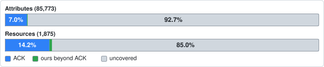

# ack-extensions

Kubernetes kinds for AWS that [AWS Controllers for Kubernetes](https://github.com/aws-controllers-k8s)
(ACK) does not have yet. They are built the way ACK builds its own
controllers, with ACK's code generator and runtime, and they run beside
ACK's controllers: per environment (a namespace with an `ACKContext`), as
that environment's own AWS identity, or beside ACK's controller as the
same identity.

ack-extensions is not affiliated with or endorsed by Amazon Web Services.

<!-- coverage:start -->
## Coverage

How much of AWS the official ACK controllers cover, and how much more this repository adds, counted in writable CloudFormation resource properties ("attributes") per service. Generated by `hack/coverage/run.sh`; the method, pinned sources and caveats are in [docs/coverage/README.md](docs/coverage/README.md).



`quicksight` alone is 51,640 of the 85,773 attributes, so the attribute bar mostly describes it; the resource bar counts a resource as covered if ACK has a kind for it, however few of its fields.

Of 85,773 attributes in 1875 resources across 305 services, ACK covers 6,033 (7.0%) and ours adds 1,465 more (1.7%), 22 of them copied from open upstream pull requests. By resource, ACK has a released kind for 266 of 1,875 (14.2%) and ours adds 120 more (6.4%).

The purple bar is **Terraform** for comparison: the share of the same attributes that a writable attribute of the Terraform `aws` provider matches, about 64.4% (at least 48.8%, the dark tick, by the strict rule). It is an estimate from the High Five Labs catalog repository, pinned like every other input, with the error of its matching; see [Terraform](docs/coverage/README.md#terraform).

Not every service matters equally. Each service has a **category**: *platform-foundation* (what a platform team needs to stand up a target, up to a managed Kubernetes cluster: Organizations and Control Tower, IAM and Identity Center, VPC networking and DNS, KMS, CloudTrail, RAM, EKS and ECR), *security-adjacent* (Config, GuardDuty, Security Hub, WAF, Secrets Manager, ACM, ...), *application* (S3, SQS, Lambda, RDS, DynamoDB, ...) or *other*. Tier 1 is platform-foundation, tier 2 is security-adjacent plus the application services some tracked Terraform module uses, tier 3 is everything else ([how and why](docs/coverage/README.md#tiers); the hand-editable list is [priority.csv](docs/coverage/priority.csv)). In each group the upper bar is attributes, the middle one resources, and the thin purple one the Terraform estimate of attributes.


| Category | Services | Resources (ACK / ours beyond) | Attributes (ACK / ours beyond) | Terraform attributes (estimate) |
| --- | ---: | ---: | ---: | ---: |
| platform-foundation | 16 | 22.8% / 14.5% | 28.2% / 8.5% | ~51.5% (≥43.5%) |
| security-adjacent | 18 | 12.5% / 67.9% | 37.6% / 50.9% | ~74.1% (≥72.0%) |
| application | 33 | 40.5% / 3.4% | 48.2% / 4.2% | ~50.8% (≥46.4%) |
| other | 238 | 7.2% / 0.0% | 3.0% / 0.0% | ~65.4% (≥48.5%) |

The ranked work queue for the foundation and security categories, resource by resource, with what upstream has and what to build first, is [docs/coverage/foundation.md](docs/coverage/foundation.md).


| Tier | Services | Resources (ACK / ours beyond) | Attributes (ACK / ours beyond) | Terraform attributes (estimate) |
| --- | ---: | ---: | ---: | ---: |
| 1 | 16 | 22.8% / 14.5% | 28.2% / 8.5% | ~51.5% (≥43.5%) |
| 2 | 51 | 32.1% / 22.7% | 44.9% / 18.4% | ~57.9% (≥54.2%) |
| 3 | 238 | 7.2% / 0.0% | 3.0% / 0.0% | ~65.4% (≥48.5%) |

| Tier | Category | Service | Coverage | Official | Ours beyond | Uncovered | Terraform (estimate) |
| ---: | --- | --- | --- | ---: | ---: | ---: | ---: |
| 1 | platform-foundation | `ec2` |  | 22.7% | 5.7% | 71.6% | ~48.8% (≥36.1%) |
| 1 | platform-foundation | `eks` |  | 82.5% | 0.0% | 17.5% | ~57.5% (≥57.5%) |
| 1 | platform-foundation | `route53resolver` |  | 35.1% | 44.2% | 20.8% | ~63.6% (≥63.6%) |
| 1 | platform-foundation | `route53` |  | 47.9% | 10.4% | 41.7% | ~24.0% (≥24.0%) |
| 1 | platform-foundation | `iam` |  | 41.2% | 17.6% | 41.2% | ~49.4% (≥49.4%) |
| 1 | platform-foundation | `ecr` |  | 63.0% | 7.4% | 29.6% | ~53.7% (≥53.7%) |
| 1 | platform-foundation | `cloudtrail` |  | 37.3% | 0.0% | 62.7% | ~22.7% (≥22.7%) |
| 1 | platform-foundation | `sso` |  | 0.0% | 61.0% | 39.0% | ~73.2% (≥68.3%) |
| 1 | platform-foundation | `controltower` |  | 0.0% | 100.0% | 0.0% | ~83.3% (≥83.3%) |
| 1 | platform-foundation | `kms` |  | 54.5% | 22.7% | 22.7% | ~72.7% (≥72.7%) |
| 1 | platform-foundation | `organizations` |  | 42.9% | 38.1% | 19.0% | ~90.5% (≥90.5%) |
| 1 | platform-foundation | `ram` |  | 54.2% | 0.0% | 45.8% | ~62.5% (≥62.5%) |
| 1 | platform-foundation | `directconnect` |  | 0.0% | 0.0% | 100.0% | ~24.7% (≥24.7%) |
| 1 | platform-foundation | `identitystore` |  | 0.0% | 0.0% | 100.0% | ~77.8% (≥77.8%) |
| 1 | platform-foundation | `networkmanager` |  | 0.0% | 0.0% | 100.0% | ~94.0% (≥94.0%) |
| 1 | platform-foundation | `route53profiles` |  | 0.0% | 0.0% | 100.0% | ~85.7% (≥85.7%) |

<details><summary>The 70 tier 2 and 3 services with any coverage</summary>

| Tier | Category | Service | Coverage | Official | Ours beyond | Uncovered | Terraform (estimate) |
| ---: | --- | --- | --- | ---: | ---: | ---: | ---: |
| 2 | security-adjacent | `wafv2` |  | 82.6% | 2.9% | 14.5% | ~96.0% (≥95.3%) |
| 2 | security-adjacent | `securityhub` |  | 0.0% | 100.0% | 0.0% | ~78.7% (≥77.5%) |
| 2 | application | `dms` |  | 68.1% | 0.0% | 31.9% | ~56.9% (≥56.9%) |
| 2 | application | `ecs` |  | 53.6% | 0.0% | 46.4% | ~65.2% (≥63.2%) |
| 2 | application | `cloudfront` |  | 63.3% | 0.0% | 36.7% | ~61.7% (≥20.6%) |
| 2 | application | `rds` |  | 53.8% | 6.6% | 39.6% | ~19.2% (≥18.6%) |
| 2 | application | `autoscaling` |  | 38.5% | 35.9% | 25.5% | ~74.9% (≥74.0%) |
| 2 | security-adjacent | `inspectorv2` |  | 0.0% | 100.0% | 0.0% | ~69.8% (≥69.8%) |
| 2 | security-adjacent | `acmpca` |  | 95.1% | 2.8% | 2.1% | ~25.2% (≥16.1%) |
| 2 | application | `pipes` |  | 85.1% | 0.0% | 14.9% | ~89.4% (≥89.4%) |
| 2 | application | `elasticloadbalancingv2` |  | 76.0% | 0.0% | 24.0% | ~11.7% (≥11.7%) |
| 2 | application | `elasticache` |  | 79.2% | 0.0% | 20.8% | ~69.8% (≥69.8%) |
| 2 | application | `s3` |  | 47.5% | 0.0% | 52.5% | ~21.5% (≥17.7%) |
| 2 | security-adjacent | `config` |  | 0.0% | 100.0% | 0.0% | ~49.2% (≥49.2%) |
| 2 | application | `events` |  | 59.2% | 28.5% | 12.3% | ~25.4% (≥23.8%) |
| 2 | application | `lambda` |  | 42.6% | 3.3% | 54.1% | ~57.0% (≥57.0%) |
| 2 | security-adjacent | `networkfirewall` |  | 56.0% | 31.0% | 12.9% | ~76.7% (≥72.4%) |
| 2 | application | `apigatewayv2` |  | 62.0% | 0.0% | 38.0% | ~72.8% (≥72.8%) |
| 2 | security-adjacent | `guardduty` |  | 0.0% | 100.0% | 0.0% | ~69.7% (≥69.7%) |
| 2 | application | `opensearchservice` |  | 62.6% | 0.0% | 37.4% | ~0.0% (≥0.0%) |
| 2 | security-adjacent | `fms` |  | 0.0% | 100.0% | 0.0% | ~65.0% (≥65.0%) |
| 2 | application | `cloudwatch` |  | 25.3% | 0.0% | 74.7% | ~41.9% (≥40.6%) |
| 2 | application | `ssm` |  | 31.7% | 0.0% | 68.3% | ~55.1% (≥50.9%) |
| 2 | application | `msk` |  | 31.9% | 0.0% | 68.1% | ~76.9% (≥60.6%) |
| 2 | application | `scheduler` |  | 0.0% | 100.0% | 0.0% | ~89.1% (≥89.1%) |
| 2 | application | `applicationautoscaling` |  | 35.1% | 7.4% | 57.4% | ~0.0% (≥0.0%) |
| 2 | security-adjacent | `auditmanager` |  | 0.0% | 100.0% | 0.0% | ~54.3% (≥51.4%) |
| 2 | application | `dynamodb` |  | 21.9% | 0.0% | 78.1% | ~11.9% (≥5.6%) |
| 2 | security-adjacent | `macie` |  | 0.0% | 100.0% | 0.0% | ~60.6% (≥60.6%) |
| 2 | application | `efs` |  | 86.5% | 0.0% | 13.5% | ~62.2% (≥62.2%) |
| 2 | security-adjacent | `securitylake` |  | 0.0% | 100.0% | 0.0% | ~71.9% (≥37.5%) |
| 2 | security-adjacent | `certificatemanager` |  | 88.2% | 2.9% | 8.8% | ~20.6% (≥20.6%) |
| 2 | application | `s3files` |  | 87.1% | 0.0% | 12.9% | ~80.6% (≥80.6%) |
| 2 | security-adjacent | `accessanalyzer` |  | 0.0% | 100.0% | 0.0% | ~60.9% (≥43.5%) |
| 2 | application | `logs` |  | 13.6% | 0.0% | 86.4% | ~67.5% (≥67.5%) |
| 2 | application | `s3tables` |  | 38.9% | 0.0% | 61.1% | ~27.8% (≥25.9%) |
| 2 | application | `sns` |  | 61.8% | 0.0% | 38.2% | ~64.7% (≥64.7%) |
| 2 | application | `sqs` |  | 81.0% | 0.0% | 19.0% | ~57.1% (≥57.1%) |
| 2 | application | `stepfunctions` |  | 45.9% | 0.0% | 54.1% | ~27.0% (≥27.0%) |
| 2 | application | `s3vectors` |  | 78.9% | 0.0% | 21.1% | ~89.5% (≥89.5%) |
| 2 | security-adjacent | `secretsmanager` |  | 17.8% | 13.3% | 68.9% | ~13.3% (≥13.3%) |
| 2 | security-adjacent | `detective` |  | 0.0% | 100.0% | 0.0% | ~66.7% (≥66.7%) |
| 2 | application | `aps` |  | 13.2% | 0.0% | 86.8% | ~34.0% (≥34.0%) |
| 2 | application | `dsql` |  | 85.7% | 0.0% | 14.3% | ~85.7% (≥85.7%) |
| 3 | other | `sagemaker` |  | 49.9% | 0.0% | 50.1% | ~45.5% (≥45.2%) |
| 3 | other | `quicksight` |  | 0.8% | 0.0% | 99.2% | ~81.8% (≥58.8%) |
| 3 | other | `bedrockagentcore` |  | 36.4% | 0.0% | 63.6% | ~66.1% (≥43.9%) |
| 3 | other | `cognito` |  | 36.8% | 0.0% | 63.2% | ~67.1% (≥64.3%) |
| 3 | other | `kinesisfirehose` |  | 26.1% | 0.0% | 73.9% | ~0.0% (≥0.0%) |
| 3 | other | `fsx` |  | 46.2% | 0.0% | 53.8% | ~37.1% (≥28.4%) |
| 3 | other | `apigateway` |  | 34.1% | 0.0% | 65.9% | ~54.3% (≥53.4%) |
| 3 | other | `memorydb` |  | 84.8% | 0.0% | 15.2% | ~86.4% (≥86.4%) |
| 3 | other | `elasticsearch` |  | 97.7% | 0.0% | 2.3% | ~68.2% (≥63.6%) |
| 3 | other | `docdb` |  | 60.3% | 0.0% | 39.7% | ~26.5% (≥26.5%) |
| 3 | other | `backup` |  | 32.0% | 0.0% | 68.0% | ~32.0% (≥24.8%) |
| 3 | other | `amazonmq` |  | 69.8% | 0.0% | 30.2% | ~0.0% (≥0.0%) |
| 3 | other | `emrserverless` |  | 88.1% | 0.0% | 11.9% | ~81.0% (≥71.4%) |
| 3 | other | `glue` |  | 5.2% | 0.0% | 94.8% | ~43.0% (≥24.2%) |
| 3 | other | `mwaa` |  | 97.2% | 0.0% | 2.8% | ~100.0% (≥100.0%) |
| 3 | other | `athena` |  | 29.9% | 0.0% | 70.1% | ~17.5% (≥17.5%) |
| 3 | other | `bedrock` |  | 5.3% | 0.0% | 94.7% | ~40.3% (≥39.9%) |
| 3 | other | `opensearchserverless` |  | 23.7% | 0.0% | 76.3% | ~63.2% (≥63.2%) |
| 3 | other | `cassandra` |  | 25.9% | 0.0% | 74.1% | ~6.9% (≥6.9%) |
| 3 | other | `mwaaserverless` |  | 81.3% | 0.0% | 18.8% | ~0.0% (≥0.0%) |
| 3 | other | `rbin` |  | 76.9% | 0.0% | 23.1% | ~76.9% (≥76.9%) |
| 3 | other | `codeartifact` |  | 36.0% | 0.0% | 64.0% | ~20.0% (≥20.0%) |
| 3 | other | `emrcontainers` |  | 9.0% | 0.0% | 91.0% | ~35.8% (≥35.8%) |
| 3 | other | `kinesis` |  | 10.2% | 0.0% | 89.8% | ~22.4% (≥22.4%) |
| 3 | other | `emr` |  | 0.5% | 0.0% | 99.5% | ~29.9% (≥17.1%) |
| 3 | other | `ses` |  | 0.4% | 0.0% | 99.6% | ~25.5% (≥17.7%) |

</details>

Services are sorted by tier, then by attributes covered, and every tier 1 service is listed even where nothing covers it; blue is covered by ACK's released controllers, green by our kinds beyond ACK, grey by neither; the thin purple bar under each is the Terraform estimate, its tick the strict floor (a dash where the estimate has no row for the service). The other 219 services in the CloudFormation schemas have no coverage and are not tier 1. Full data: [services.csv](docs/coverage/services.csv) (one row per service), [resources.csv](docs/coverage/resources.csv) (one row per resource) and [attributes.csv](docs/coverage/attributes.csv) (one row per attribute).

<!-- coverage:end -->

## Kinds

| Kind | What it does | Where it comes from |
| --- | --- | --- |
| `applicationautoscaling.aws.hfl.dev/v1alpha1` `ScheduledAction` | A scheduled change of an Application Auto Scaling target's capacity (an ECS service, a DynamoDB table, Aurora replicas), put with `PutScheduledAction`. ACK's applicationautoscaling-controller ignores the resource. | Generated, as ACK's applicationautoscaling-controller generates its own Put-shaped `ScalingPolicy`; no ACK pull request adds it |
| `autoscaling.aws.hfl.dev/v1alpha1` `ScalingPolicy` | An EC2 Auto Scaling group's scaling policy (target tracking, step, simple or predictive), put with `PutScalingPolicy` and updated in place. ACK's `AutoScalingGroup` has none, and a group without policies does not scale. | Generated, configured as ACK's applicationautoscaling-controller generates its own Put-shaped `ScalingPolicy`, with its server-defaults delta hook copied; no ACK pull request adds it |
| `autoscaling.aws.hfl.dev/v1alpha1` `ScheduledAction` | A scheduled change of an EC2 Auto Scaling group's capacity, once or on a recurrence, put with `PutScheduledUpdateGroupAction`. ACK's `AutoScalingGroup` has none. | Generated, as `ScalingPolicy`; no ACK pull request adds it |
| `ec2.aws.hfl.dev/v1alpha1` `CustomerGateway` | The on-premises end of a site-to-site VPN (address, BGP ASN, type), with tags. ACK's ec2-controller ignores it. | Generated, with ACK ec2-controller's own tag patterns copied from its `InternetGateway`; no ACK pull request adds it |
| `ec2.aws.hfl.dev/v1alpha1` `VPNGateway` | The AWS end of a site-to-site VPN, attached to a VPC (moved when `spec.vpc` changes, detached before delete), with tags. ACK's ec2-controller ignores it. | Generated, with the VPC attachment and tag hooks of ACK ec2-controller's `InternetGateway` copied; no ACK pull request adds it |
| `ec2.aws.hfl.dev/v1alpha1` `Volume` | An EBS volume: created, grown or changed in type, IOPS and throughput with `ModifyVolume`, tagged, and deleted. ACK's ec2-controller ignores it. | Generated (with generator patch 0002), with ACK ec2-controller's tag patterns; no ACK pull request adds it |
| `ec2.aws.hfl.dev/v1alpha1` `VolumeAttachment` | An EBS volume attached to an instance as a device, by ID or by reference to our `Volume`; detached on delete and attached again if detached outside Kubernetes. ACK's ec2-controller has no attachment. | Hand-written on iam-controller PR #184's skeleton; no ACK pull request adds it |
| `eventbridge.aws.hfl.dev/v1alpha1` `APIDestination` | An EventBridge API destination: the endpoint, method and rate limit a rule sends events to, through a `Connection` it references. ACK's eventbridge-controller ignores it. | Generated; no ACK pull request adds it |
| `ecr.aws.hfl.dev/v1alpha1` `ReplicationConfiguration` | An ECR registry's replication rules, put whole and put back when changed outside Kubernetes; delete puts no rules. ACK's ecr-controller has no replication. | ecr-controller PR #121 (API and behaviour), on PR #184's hand-written skeleton |
| `eventbridge.aws.hfl.dev/v1alpha1` `Connection` | An EventBridge connection: the credentials (basic, API key, OAuth) an API destination calls an endpoint with, its secrets read from Kubernetes Secrets. ACK's eventbridge-controller ignores it. | Generated; no ACK pull request adds it |
| `iam.aws.hfl.dev/v1alpha1` `RolePolicyAttachment` | Attaches one managed policy to one IAM role, and detaches it on delete. It is for a role ACK does not manage (made by another team, by Terraform, or by EKS for a node group). | Copied from ACK iam-controller pull request #184 (open) |
| `iam.aws.hfl.dev/v1alpha1` `UserGroupMembership` | An IAM user in a list of groups, by name or by reference to ACK's `User` and `Group`s. Not exclusive: only the listed groups are added or removed, and a group taken off the list is removed. ACK's iam-controller has no membership. | Hand-written on iam-controller PR #184's skeleton; no ACK pull request adds it |
| `iam.aws.hfl.dev/v1alpha1` `LoginProfile` | An IAM user's console password, from a Kubernetes Secret, and whether it must be reset at first sign-in. ACK's iam-controller has none. | Generated; ACK's PR #147 was closed |
| `iam.aws.hfl.dev/v1alpha1` `SSHPublicKey` | An IAM user's SSH public key for CodeCommit, active or inactive, by user name or by reference to ACK's `User`. ACK's iam-controller has none. | Hand-written on iam-controller PR #184's skeleton; no ACK pull request adds it |
| `iam.aws.hfl.dev/v1alpha1` `AccountAlias` | The account's sign-in alias, set back if changed outside Kubernetes. ACK's iam-controller has none. | Hand-written on iam-controller PR #184's skeleton; no ACK pull request adds it |
| `iam.aws.hfl.dev/v1alpha1` `AccountPasswordPolicy` | The account's password policy for IAM users (length, character classes, age, reuse), put back if changed outside Kubernetes. ACK's iam-controller has none. | Hand-written on iam-controller PR #184's skeleton; no ACK pull request adds it |
| `organizations.aws.hfl.dev/v1alpha1` `AccountPlacement` | The OU (or root) a member account is in, by ID or by reference to ACK's `Account` and `OrganizationalUnit`; moved with `MoveAccount` when the spec changes, and moved back if moved outside Kubernetes. Deleting it leaves the account where it is, and the retain-only admission policy requires `services.k8s.aws/deletion-policy: retain` on every object. ACK's organizations-controller has no way to move an account (community #2369). | Generated (`MoveAccount`, `ListParents`), with three short hooks |
| `organizations.aws.hfl.dev/v1alpha1` `DelegatedAdministrator` | A member account registered as an AWS service's delegated administrator for the organization (GuardDuty, Security Hub, Config, Identity Center and the rest), by account ID or by reference to ACK's `Account`; registered again if removed outside Kubernetes, deregistered on delete. ACK has none; community #2884 proposes it, with no pull request. | Generated (`RegisterDelegatedAdministrator`, `DeregisterDelegatedAdministrator`, `ListDelegatedAdministrators`) |
| `organizations.aws.hfl.dev/v1alpha1` `Organization` | The account's organization, adopted (or made when there is none): its feature set, the policy types enabled on its root and the services with trusted access. The two lists are additive: what is listed is put back if disabled outside Kubernetes; what is enabled outside it is kept and reported in `status.unmanaged…` for import, and only what the object owns is disabled. Never deleted from Kubernetes: the controller has no `DeleteOrganization`, and an admission policy requires `services.k8s.aws/deletion-policy: retain` on every object. ACK's organizations-controller ignores `Organization`. | Generated (`CreateOrganization`, `DescribeOrganization`), the two lists by hand |
| `organizations.aws.hfl.dev/v1alpha1` `Policy` | An AWS Organizations policy: a service control policy, resource control policy, tag policy or another type, with its tags; the document is compared as JSON. ACK's organizations-controller has `Account` and `OrganizationalUnit` only and ignores `Policy`; no pull request adds it. | Generated, with eventbridge-controller's tag hooks |
| `organizations.aws.hfl.dev/v1alpha1` `PolicyAttachment` | One Organizations policy attached to one root, OU or account, by ID or by reference to our `Policy` and ACK's `OrganizationalUnit`; attached again if detached outside Kubernetes, detached on delete, and the target's other policies left alone. ACK has no attachment; community #2884 proposes one, with no pull request. | Generated (`AttachPolicy`, `DetachPolicy`, `ListTargetsForPolicy`) |
| `rds.aws.hfl.dev/v1alpha1` `OptionGroup` | An RDS option group (MySQL, MariaDB, SQL Server and Oracle options such as the audit plugin), with its options added and removed through `ModifyOptionGroup`. | Generated from ACK rds-controller pull request #257 (open) |
| `rds.aws.hfl.dev/v1alpha1` `DBProxyTarget` | Registers an RDS instance or an Aurora cluster with an RDS Proxy. ACK's `DBProxy` makes a proxy but never registers what it fronts, so without this the proxy accepts no connections. It becomes synced once RDS Proxy reports every target `AVAILABLE`. | New: no ACK code or pull request covers it |
| `kms.aws.hfl.dev/v1alpha1` `ReplicaKey` | A multi-Region KMS key's replica in another Region: created with `ReplicateKey` in the primary key's Region, then read, changed (policy, tags) and deleted in its own Region, never touching the primary key. | Copied from ACK kms-controller pull request #112 (open), with its Region handling corrected: the pull request's read, update and delete act on the primary key |
| `lambda.aws.hfl.dev/v1alpha1` `Permission` | One statement of a Lambda function's resource-based policy (`AddPermission`), so that S3, an ALB, EventBridge or SNS may invoke the function; removed on delete, and added back if removed outside Kubernetes. ACK has permissions only inside an `Alias`. | New: the calls and policy reading are copied from ACK's `Alias`; no ACK pull request adds the kind |
| `rds.aws.hfl.dev/v1alpha1` `DBRoleAssociation` | Associates an IAM role with an Aurora cluster or an RDS instance for one feature (`s3Import`, `s3Export`, `Lambda`, `S3_INTEGRATION`), and removes it on delete. ACK's `DBCluster` and `DBInstance` only report associated roles. It becomes synced once RDS reports the association `ACTIVE`. | New: no ACK code or pull request covers it |
| `scheduler.aws.hfl.dev/v1alpha1` `Schedule` | An EventBridge Scheduler schedule: an expression that invokes a target as a role, in a group by name or by reference to our `ScheduleGroup`. ACK has no Scheduler controller. | Generated |
| `scheduler.aws.hfl.dev/v1alpha1` `ScheduleGroup` | An EventBridge Scheduler schedule group, with its tags. ACK has no Scheduler controller; the manager runs beside ACK's EventBridge controller. | Generated, with eventbridge-controller's tag hooks |
| `wafv2.aws.hfl.dev/v1alpha1` `WebACLAssociation` | A regional web ACL associated with a load balancer, API stage or other resource, by ARN or by reference to ACK's `WebACL`; associated again if removed outside Kubernetes, disassociated on delete. ACK's wafv2-controller has no association. | Hand-written on iam-controller PR #184's skeleton; no ACK pull request adds it |

Each kind can reference ACK's own objects, the way ACK's kinds reference
each other: `RolePolicyAttachment.spec.roleRef` names an
`iam.services.k8s.aws` `Role`, and `DBProxyTarget.spec.dbProxyRef`,
`dbInstanceRef` and `dbClusterRef` name ACK's `DBProxy`, `DBInstance` and
`DBCluster`; `DBRoleAssociation.spec.dbClusterRef`, `dbInstanceRef` and
`roleRef` name ACK's `DBCluster`, `DBInstance` and `iam.services.k8s.aws`
`Role`; `Permission.spec.functionRef` names ACK's `lambda.services.k8s.aws`
`Function`; `ReplicaKey.spec.keyRef` names ACK's `kms.services.k8s.aws`
`Key`.

ACK's annotations mean what they mean in ACK, because the reconciler is
ACK's runtime: `services.k8s.aws/deletion-policy: retain`,
`services.k8s.aws/region`, adoption, the cross-account role maps (CARM)
and `IAMRoleSelector`.

## Cloud Control kinds

For AWS types ACK has no controller for, a second route: kinds generated
from the CloudFormation registry schemas and served through the AWS Cloud
Control API by one generic manager on ACK's runtime, in
`<service>.cloudcontrol.aws.hfl.dev` (`docs/cloudcontrol.md`). Proven
against a fake Cloud Control over moto; **untested on real AWS** until
each has had a real run.

| Kind | CloudFormation type |
| --- | --- |
| `iam.cloudcontrol.aws.hfl.dev/v1alpha1` `SAMLProvider` | `AWS::IAM::SAMLProvider` (the private key from a Secret) |
| `ec2.cloudcontrol.aws.hfl.dev/v1alpha1` `TransitGatewayRouteTable` | `AWS::EC2::TransitGatewayRouteTable` |
| `guardduty.cloudcontrol.aws.hfl.dev/v1alpha1` `Detector` | `AWS::GuardDuty::Detector` |
| `sso.cloudcontrol.aws.hfl.dev/v1alpha1` `PermissionSet` | `AWS::SSO::PermissionSet` (Identity Center) |
| `sso.cloudcontrol.aws.hfl.dev/v1alpha1` `Assignment` | `AWS::SSO::Assignment` (a permission set for a user or group in an account) |
| `sso.cloudcontrol.aws.hfl.dev/v1alpha1` `InstanceAccessControlAttributeConfiguration` | `AWS::SSO::InstanceAccessControlAttributeConfiguration`; **unproven on the fake** (moto has none of its API) |
| `ec2.cloudcontrol.aws.hfl.dev/v1alpha1` `TransitGatewayRouteTableAssociation` | `AWS::EC2::TransitGatewayRouteTableAssociation` (an attachment's route table) |
| `ec2.cloudcontrol.aws.hfl.dev/v1alpha1` `TransitGatewayRouteTablePropagation` | `AWS::EC2::TransitGatewayRouteTablePropagation` (an attachment's routes put in a table) |
| `ec2.cloudcontrol.aws.hfl.dev/v1alpha1` `TransitGatewayRoute` | `AWS::EC2::TransitGatewayRoute` (a static or blackhole route) |
| `ec2.cloudcontrol.aws.hfl.dev/v1alpha1` `TransitGatewayPeeringAttachment` | `AWS::EC2::TransitGatewayPeeringAttachment`; the requester's side: the peer accepts it outside the kind |
| `controltower.cloudcontrol.aws.hfl.dev/v1alpha1` `EnabledControl` | `AWS::ControlTower::EnabledControl` (a control on an OU); **unproven on the fake** (no emulator has Control Tower) |
| `controltower.cloudcontrol.aws.hfl.dev/v1alpha1` `EnabledBaseline` | `AWS::ControlTower::EnabledBaseline` (a baseline on an OU or account); **unproven on the fake** |
| `controltower.cloudcontrol.aws.hfl.dev/v1alpha1` `LandingZone` | `AWS::ControlTower::LandingZone`; **never deleted** (deleting the object keeps the landing zone) and retain-only (every object carries `services.k8s.aws/deletion-policy: retain`); proven on a test double of ours, since no emulator has Control Tower |
| `secretsmanager.cloudcontrol.aws.hfl.dev/v1alpha1` `ResourcePolicy` | `AWS::SecretsManager::ResourcePolicy` (a secret's resource policy; the secret by ARN) |

They run per environment: a `CloudControlContext` named `cloudcontrol` in
a namespace makes the operator run a manager for that namespace, watching
only it, as the ServiceAccount
`ack-extensions-system/ack-extensions-cloudcontrol-<namespace>`, which an
EKS Pod Identity association binds to the environment's IAM role:

```yaml
apiVersion: cloudcontrol.aws.hfl.dev/v1alpha1
kind: CloudControlContext
metadata: {name: cloudcontrol, namespace: team-a-prod}
spec:
  roleARN: arn:aws:iam::111122223333:role/team-a-prod-cloudcontrol
  region: us-west-2
  kinds: [SAMLProvider.iam, Detector.guardduty]   # optional; empty: every kind
```

`task cloudcontrol:iam` writes that role's permission policies (the
generated policies of the kinds enabled) and its trust policy; the
context's `status.podIdentityAssociation` names the association to make.

## Where it sits

| | ACK | ack-extensions |
| --- | --- | --- |
| API groups | `<service>.services.k8s.aws` | `<service>.aws.hfl.dev` |
| Example | `rds.services.k8s.aws` `DBProxy` | `rds.aws.hfl.dev` `DBProxyTarget` |
| Process | one controller per service (`ack-rds-controller`) | one manager per controller per environment (`ACKContext`), as the environment's own role; or one per service beside ACK's (`ack-extensions-rds-manager`) |
| Code | ACK's generator and runtime | ACK's generator (with one patch) and runtime, as Go modules |
| Cloud Control kinds | none | `<service>.cloudcontrol.aws.hfl.dev`, one generic manager per environment (`CloudControlContext`), as the environment's own role |

The groups never clash with ACK's, so both run on one cluster, and a kind
moves from our group to ACK's when ACK ships it.

## Install

```sh
kubectl kustomize config/default | KO_DOCKER_REPO=<registry> ko resolve -f - | kubectl apply --server-side -f -
```

This installs our CRDs, each manager's ClusterRole, `ACKContext`, and the
operator in `ack-extensions-system`. The operator then runs our managers
two ways.

### Per environment: `ACKContext` (the default for account-level kinds)

An environment is a namespace. An `ACKContext` named `ack` in it lists
the controllers (services) the environment uses; for each, the operator
runs one manager, in `ack-extensions-system`, as the ServiceAccount
`ack-extensions-<service>-<namespace>`, watching only that namespace and
holding Kubernetes rights only there. One EKS Pod Identity association
per manager binds it to the environment's IAM role (the builder,
2026-11-10: the same environment-scoped Pod Identity model as Cloud
Control, one manager per controller per namespace):

```yaml
apiVersion: core.aws.hfl.dev/v1alpha1
kind: ACKContext
metadata: {name: ack, namespace: team-a-prod}   # one per namespace; any other name is refused
spec:
  roleARN: arn:aws:iam::111122223333:role/team-a-prod-ack
  region: us-west-2
  controllers:
    - service: rds
      kinds: [OptionGroup, DBProxyTarget]   # optional; empty: every kind of the service
    - service: scheduler
```

`status.podIdentityAssociations` names the associations to make, and
`task ack:iam CONTEXT=<that file> ACCOUNT=<id> CLUSTER_ARN=<arn> OUT=<dir>`
writes the role's permission policies (the actions of the kinds enabled,
read from the generated code, plus a few curated ones such as
`iam:PassRole`) and its trust policy (only these managers'
ServiceAccounts, by Pod Identity's session tags). The operator refuses,
in `status.refused`, `organizations` (it keeps its own install, below),
an unknown service or kind, and a service whose kinds in that namespace
are already served by our manager beside an ACK controller that watches
it. `docs/plan.md`, section 7.6, has the details.

### Beside ACK's controller

For each ACK controller the operator finds (by its chart's label,
`app.kubernetes.io/name: <service>-chart`), it runs our manager in the
same namespace with the controller's own arguments, environment and
credentials, as the same identity. The Organizations kinds always run
this way (below); for account-level kinds, narrow ACK's controller's
`watchNamespace` to keep it off the namespaces that have an `ACKContext`.

### AWS identity, beside ACK's controller

By default (`--identity=own`) our manager runs as its own ServiceAccount,
`ack-extensions-<service>-manager`, which carries the ACK ServiceAccount's
`eks.amazonaws.com/role-arn` annotation. It acts as the same IAM role, but
holds only our kinds' rights in the cluster. AWS needs one more grant per
role:

- IRSA: add our ServiceAccount to the role's trust policy, beside ACK's
  (`system:serviceaccount:<namespace>:ack-extensions-<service>-manager`).
- EKS Pod Identity: one more association, for our ServiceAccount, to the
  same role.
- A credentials Secret (`aws.credentials.secretName` in ACK's chart): no
  step; our manager mounts the same Secret.

**Organizations** (`docs/plan.md`, section 7.5): ACK's
organizations-controller runs alone in a namespace kept for
organization-level objects (`ack-organizations-system`), with an
organization-scoped role bound by **EKS Pod Identity**, not IRSA: no
role annotation on ACK's ServiceAccount, and one association each for
`ack-organizations-controller` and `ack-extensions-organizations-manager`
in that namespace. The operator refuses to run the Organizations manager
beside any other ACK controller in the same namespace, removes one it ran
there, and records a `SharedNamespace` Warning event on ACK's
Deployment.

EventBridge Scheduler has no ACK controller. Its manager runs beside ACK's
EventBridge controller, as that controller's identity, so that role needs
`scheduler:*`, and `iam:PassRole` for the roles schedules invoke their
targets with.

With `--identity=ack`, or the annotation `aws.hfl.dev/identity: ack` on
ACK's controller Deployment, our manager runs as ACK's ServiceAccount
instead. That needs no AWS change, but our manager then holds every
Kubernetes right ACK's controller holds, including full control of ACK's
own kinds. `docs/plan.md`, section 7, compares the two.

## Develop

The tasks are in `Taskfile.yml` (run with [Task](https://taskfile.dev); `task` lists them).

```sh
task tools         # ACK's generator at the pin, controller-gen, goimports, setup-envtest, moto
task check         # generated files current, gofmt, vet, SPDX lines, build, tests
task operator-e2e  # the operator on kind beside ACK's real rds-controller and per environment, against moto
task ack:iam LIST=1  # every ACK-generated kind's IAM actions
```

The tests use moto, a fake AWS, in server mode. Nothing here uses real
AWS credentials. See `CONTRIBUTING.md`, and `docs/plan.md` for how the
repository is built, kept in step with ACK, and tested.

## Licence

Apache-2.0 (`LICENSE`). Files copied or generated from ACK keep Amazon's
copyright and licence header (`NOTICE`, `UPSTREAM.md`).
