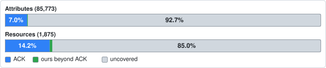

# Coverage of AWS: ACK and ack-extensions

<!-- Generated by hack/coverage/run.sh; do not edit. The spot-check section comes from hack/coverage/spotchecks.md. -->

This directory measures how much of AWS is covered by Kubernetes kinds: by the controllers ACK releases (**official**), and by the kinds in this repository (**ours**) beyond them. The root [README](../../README.md) shows the summary; the data is here.



| | Resources | Attributes |
| --- | ---: | ---: |
| In the CloudFormation schemas (the denominator) | 1,875 | 85,773 |
| Covered by an official ACK kind | 266 | 6,033 (7.0%) |
| Covered by ours, beyond official | 18 | 250 (0.3%) |
| Covered by neither | 1,591 | 79,490 (92.7%) |

## Files

| File | One row per | Columns |
| --- | --- | --- |
| [services.csv](services.csv) | service | `service,resources_total,resources_official,resources_ours_beyond,attributes_total,attributes_official,attributes_ours_beyond,attributes_uncovered,pct_official,pct_ours_beyond,pct_uncovered` |
| [resources.csv](resources.csv) | resource | `service,resource,attributes_total,official_kinds,attributes_official,ours_kinds,attributes_ours_beyond,attributes_uncovered,ours_from_upstream_pr,notes` |
| [attributes.csv](attributes.csv) | attribute | `service,resource,attribute,type,required,covered_by,official_path,ours_path` |
| `bars/<service>.svg`, `bars/_total.svg` | service, and all | stacked bars: official blue, ours beyond official green, uncovered light grey; `_total.svg` shows attributes and resources |
| [priority.csv](priority.csv) | service | `service,tier,category,rationale,source`: the tier and category of each service, **hand-edited input** (see Tiers); a service not in it is tier 3, category `other` |
| [foundation.md](foundation.md) | | the ranked **foundation gap report**: the work queue for the kind agents (platform-foundation and security-adjacent resources: what ACK and we cover, what upstream has or is building, moto, size, proposed kinds) |
| [categories.csv](categories.csv), `bars/_categories.svg` | category | the same columns as `tiers.csv`, for `platform-foundation`, `security-adjacent`, `application`, `other` |
| [tiers.csv](tiers.csv), `bars/_tiers.svg` | tier | `tier,services,resources_total,resources_official,resources_ours_beyond,resources_uncovered,attributes_total,attributes_official,attributes_ours_beyond,attributes_uncovered,pct_attributes_official,pct_attributes_ours_beyond,pct_attributes_uncovered,pct_resources_official,pct_resources_ours_beyond,pct_resources_uncovered` |
| [sources.yaml](sources.yaml) | | every pinned input: the schema zip and each ACK controller's release and commit |

In `attributes.csv`, `covered_by` is `official` (an official ACK kind covers it and ours does not), `ours` (ours covers it and official does not), `both`, or `none`; `official_path` and `ours_path` are the CRD `spec` path that covers it (`;`-separated, with the kind in front when several kinds of that side cover the resource). In `services.csv` and `resources.csv`, `attributes_official` counts `official` and `both`, `attributes_ours_beyond` counts `ours` only, and the three percentages are of `attributes_total` (so each row adds to 100.0, give or take rounding). `resources_official` counts resources with an official kind; `resources_ours_beyond` counts resources with a kind of ours and none official. `notes` carries `official_unmapped=N` and `ours_unmapped=N` (spec paths of the CRDs that matched no CloudFormation property), the kind of ours that is a property of a larger resource, and `outside-denominator`.

## Definitions

- **service**: an AWS service, by its CloudFormation service name lower-cased (`rds`, `lambda`, `events` for EventBridge, `elasticloadbalancingv2` for ELBv2). A CloudFormation service is the second part of `AWS::<Service>::<Resource>`.
- **resource**: one CloudFormation resource type, written `rds/DBInstance` for `AWS::RDS::DBInstance`.
- **attribute**: a *writable* (input) property of a resource, as a dotted path: arrays as `[]`, maps as `{}`, so `Tags[].Key` and `SecurityGroupIds[]`. Only leaves count: an object with properties is not itself an attribute, but its properties are; an object with no declared properties (a free-form JSON value) is one attribute. A property is **read-only** if its pointer, or one above it, is in the schema's `readOnlyProperties`; read-only properties are excluded. `createOnlyProperties` are *not* excluded: they are writable at create. `writeOnlyProperties` (passwords) are writable and counted. `required` is true only if the property and every object above it are required. Where a schema defines a definition that contains itself (WAFv2 statements, Glue and Lex structures), the walk stops at the second occurrence and counts the cut point as one free-form attribute; that happened 187 times across the schemas.
- **official**: covered by ACK's own controllers (`aws-controllers-k8s/<service>-controller`) at the **latest release** of each. A service is covered when the controller's released CRDs (`helm/crds/` at the release commit) have a CRD for the resource. Controllers with no release are not official (listed below).
- **ours**: covered by a kind in this repository's CRDs (`config/crds/bases/`, at the commit being measured). A kind whose coverage is copied from an open upstream pull request has `ours_from_upstream_pr=true` (22 of the attributes ours adds beyond official come only from such kinds).
- **uncovered**: in the CloudFormation schemas, covered by neither.

## Tiers and categories

Services do not matter equally: `quicksight` alone has more attributes than all of tier 1 together, yet a platform team needs `organizations`, `iam`, VPC networking and `eks` first. So every service has a **category** and a **tier**, and the README shows coverage by both as well as in total.

**Categories** (the builder's, 2026-11-09):

- **platform-foundation**: everything up to a managed Kubernetes cluster, which is table stakes for a platform team establishing a target: Organizations (accounts, OUs, SCPs and the other policy types, delegated administrators, organization features), Control Tower, IAM (roles, policies, boundaries, OIDC and SAML providers), IAM Identity Center and the Identity Store, Resource Access Manager, VPC networking and DNS (`ec2` for VPC, subnets, route tables, gateways, Transit Gateway, endpoints, security groups, NACLs and VPN; `route53`, `route53resolver`, `route53profiles`; `networkmanager`, `directconnect`), KMS, CloudTrail, EKS and ECR: `cloudtrail`, `controltower`, `directconnect`, `ec2`, `ecr`, `eks`, `iam`, `identitystore`, `kms`, `networkmanager`, `organizations`, `ram`, `route53`, `route53profiles`, `route53resolver`, `sso`.
- **security-adjacent**: what security teams need next to it: Config, GuardDuty, Security Hub, Macie, Inspector, Detective, Access Analyzer, Firewall Manager, WAF, Secrets Manager, ACM and private CAs, Audit Manager, Security Lake, Network Firewall: `accessanalyzer`, `acmpca`, `auditmanager`, `certificatemanager`, `config`, `detective`, `fms`, `guardduty`, `inspector`, `inspectorv2`, `macie`, `networkfirewall`, `secretsmanager`, `securityhub`, `securitylake`, `waf`, `wafregional`, `wafv2`.
- **application**: application primitives (S3, SQS, SNS, Lambda, RDS, DynamoDB, ElastiCache, ECS and so on): the services some tracked Terraform module uses that are in neither category above (33 services; the list is `priority.csv`).
- **other**: everything else in the CloudFormation schemas (238 services). A service missing from `priority.csv` is tier 3, category `other`.

**Tiers**: tier 1 is the platform-foundation services; tier 2 is the security-adjacent services and the application services some tracked module uses; tier 3 is everything else. (Before 2026-11-09 tier 1 was the services of the ten most-downloaded terraform-aws-modules; the builder's brief replaced that where the two conflict, so `s3`, `lambda`, `rds` and `logs` moved to tier 2. The module-usage ranking stays as each row's rationale.)

| Category | Services | Resources | ACK | Ours beyond | Attributes | ACK | Ours beyond |
| --- | ---: | ---: | ---: | ---: | ---: | ---: | ---: |
| platform-foundation | 16 | 241 | 22.8% | 3.3% | 2,400 | 28.2% | 1.9% |
| security-adjacent | 18 | 112 | 12.5% | 0.9% | 2,082 | 37.6% | 0.1% |
| application | 33 | 262 | 40.5% | 3.4% | 4,766 | 48.2% | 4.2% |
| other | 238 | 1,260 | 7.2% | 0.0% | 76,525 | 3.0% | 0.0% |

| Tier | Services | Resources | ACK | Ours beyond | Attributes | ACK | Ours beyond |
| ---: | ---: | ---: | ---: | ---: | ---: | ---: | ---: |
| 1 | 16 | 241 | 22.8% | 3.3% | 2,400 | 28.2% | 1.9% |
| 2 | 51 | 374 | 32.1% | 2.7% | 6,848 | 44.9% | 3.0% |
| 3 | 238 | 1,260 | 7.2% | 0.0% | 76,525 | 3.0% | 0.0% |

**The foundation gap report.** [foundation.md](foundation.md) ranks every resource of the platform-foundation and security-adjacent categories as a work queue for the kind agents: ACK coverage, ours, what is missing (whole resources first, then the attributes that matter), whether upstream has it or is building it (ACK controller releases, `generator.yaml` ignore lists, open pull requests and `community` issues, all read-only), how many of the 40 tracked terraform-aws-modules need it, whether moto 5.2.5 implements the API (we can only prove kinds against moto), a size estimate and the proposed kinds. Its numbers are regenerated; its research is `hack/coverage/foundation.yaml`.

**Where it comes from.** `priority.csv` is hand-edited input. The module-usage rationale came once, by hand, from the usage ranking in `catalog/docs/aws.md` (the High Five Labs catalog repository, commit `b6fdd5342346997fe855357eeee225afb7530e95`, file sha256 `8c2ab34d8e50130e19bfa0619ffc0c9800646d26e8bebac9de347a574a681533`, read 2026-11-09), which ranks the terraform-aws-modules by Terraform Registry downloads over the last year and lists what each top module and submodule creates. The categories and the tier-1 definition are the builder's brief of 2026-11-09. Services are the CloudFormation service names used everywhere else here. The generator **reads** the file and never rewrites it, so any tier or category can be overridden by editing a row; it rejects a tier outside 1 to 3, an unknown category, a duplicate, and a service that is not in the CloudFormation schemas (a typo guard).

**Limits.**

- Module usage is a proxy for what teams need, and it does not reach the foundation at all: none of the 40 tracked modules wraps Organizations, Identity Center, Control Tower, CloudTrail, Config, GuardDuty or Security Hub, so for those the builder's brief, not the modules, ranks them. Downloads count module fetches, not teams, and only the terraform-aws-modules organisation's modules are tracked: a service nobody wraps in one of them is tier 3 or `other` however important it is to you.
- A category is a whole service, but a module (or a platform team) uses a few of its resources. `ec2` is platform-foundation for networking, and its other resources (it has 126; the modules use perhaps a dozen) ride along; so the category's coverage understates how well the *used* resources are covered. [foundation.md](foundation.md) ranks the networking resources of `ec2` ahead of the rest and lists every one.
- Neither tiers nor categories weigh services within them, and `iam` (one module on every stack) counts the same as `route53profiles`.
- Coverage counts a resource that ACK or ours covers as fields of another kind (security group rules, route table routes, inline IAM policies) as uncovered, because the CloudFormation schema has a resource of its own for each; [foundation.md](foundation.md) marks those "covered inline" so they are not mistaken for gaps.
- The research behind [foundation.md](foundation.md) is a snapshot of 2026-11-09 and is not regenerated: re-read upstream before starting an item.

## Method

1. **Denominator.** The CloudFormation resource-schema zip for us-east-1 (every `AWS::*` resource type: 1,875 resources in 305 services, 85,773 writable attributes after removing 7,008 read-only leaves). `Alexa::ASK::Skill` is dropped. Resources with no writable property are kept (they count as resources, not attributes).
2. **Official.** For every ACK controller repository with a published GitHub release, the latest release's tag is resolved to a commit, and every CRD under `helm/crds/` (except ACK's own `services.k8s.aws` kinds, `FieldExport` and `IAMRoleSelector`) is read. The CRD's `spec` is walked the same way as a CloudFormation schema: leaves become dotted paths (ACK's `*Ref` reference fields are skipped, each stands for an ID field already counted; a `{name, namespace, key}` secret reference is one string).
3. **Ours.** The same walk over this repository's `config/crds/bases/*.yaml`.
4. **Which resource a kind is.** A kind is the CloudFormation resource of the same name in the same service (case and punctuation ignored: `VPCLink` is `VpcLink`). The service ids that differ are in `hack/coverage/mappings.yaml` (`acm` is `certificatemanager`, `eventbridge` is `events`, `sfn` is `stepfunctions`, `kafka` is `msk`, ...), as are the kinds whose name differs (`ElasticIPAddress` is `EIP`, `Policy` is `ManagedPolicy`) and the kinds with no CloudFormation resource. A kind of ours that is a *property* of a larger CloudFormation resource is mapped to that resource and its properties: `applicationautoscaling` `ScheduledAction` to `ScalableTarget.ScheduledActions[]`, `LoginProfile` to `User.LoginProfile`, `UserGroupMembership` to `User.Groups[]`, `RolePolicyAttachment` to `Role.ManagedPolicyArns[]`, `DBProxyTarget` to `DBProxyTargetGroup`, `DBRoleAssociation` to `DBCluster` and `DBInstance` `.AssociatedRoles[]`; the resource row says so in `notes`.
5. **Which attribute a spec field is.** Tiers, tightest first; a looser tier sees only what the tighter ones left, and from `primary-name` down a match is accepted only when each side has exactly one candidate.

| Tier | Rule | Official | Ours |
| --- | --- | ---: | ---: |
| `exact` | the same path, names compared lower-cased without punctuation, `[]` and `{}` kept (`DBInstanceClass` and `dbInstanceClass`; ACK's `{quantity, items[]}` wrappers count as the list) | 5,174 | 229 |
| `alias` | a path-prefix rename written by hand in `mappings.yaml` (`ingressRules[]` is `SecurityGroupIngress[]`) | 145 | 24 |
| `tags-map` | CloudFormation's `Tags[].Key` and `Tags[].Value` against ACK's `tags{}` map | 74 | 0 |
| `free-form` | the CRD takes a free-form value (`x-kubernetes-preserve-unknown-fields`) above the CloudFormation path, so it covers everything under it | 0 | 0 |
| `structured` | CloudFormation takes a free-form object where the CRD has a map or declared structure under the same name (WAFv2 `Method` and `{}`, DynamoDB `KeySchema`) | 109 | 0 |
| `primary-name` | ACK's `name` field against the one writable primary-identifier property (`ClusterName`) | 35 | 0 |
| `name-suffix` | same parent, the last name of one ends with the other (`description` and `GroupDescription`, `policy` and `KeyPolicy`), unique both ways | 52 | 0 |
| `name-variant` | same path after canonicalizing each name: plurals, `identifier` and `id`, `Ids` and `s`, `enableFoo` and `fooEnabled`, `*Tags`, `tagKey` and `key`; unique both ways | 28 | 0 |
| `tail-4` | the last four names agree (a wrapper above them was renamed or dropped) and the list depth is the same, unique both ways | 30 | 0 |
| `tail-3` | the same, last three names | 77 | 0 |
| `tail-2` | the same, last two names | 192 | 2 |
| `leaf-name` | the same last name, type class and list depth, unique both ways among what is left | 117 | 5 |

The tiers run in this order in the code: exact and alias, tags-map, free-form, structured, primary-name, name-suffix, name-variant, tail-4, tail-3, tail-2, leaf-name. The first two are by design exact; the rest are heuristics, and `leaf-name` is the loosest.

To see any resource's matching, with the tier that matched each attribute and the CRD paths that matched nothing:

```sh
hack/coverage/run.sh -explain rds/DBInstance
```

## Pinned sources

**CloudFormation resource schemas.** `https://schema.cloudformation.us-east-1.amazonaws.com/CloudformationSchema.zip` (region us-east-1), fetched 2026-11-09 (`Last-Modified: Mon, 09 Nov 2026 14:29:07 GMT`), 3,320,086 bytes, sha256 `680b184be4a9fc0d936a2efc044388eb2044ea8b402777c2aece1c0449a60f1f`. AWS rebuilds the file at that URL every hour, so it cannot reproduce an old pin; the pinned copy is committed as [`inputs/CloudformationSchema.zip`](inputs/CloudformationSchema.zip) and the generator refuses a copy whose checksum differs from this one.

**ACK controllers.** aws-controllers-k8s, resolved 2026-11-09: the latest GitHub release of every `*-controller` repository that has one and has CRDs. Source: `https://raw.githubusercontent.com/aws-controllers-k8s/<repo>/<commit>/helm/crds/<file>`; the commit is the release tag resolved at the time (tags can move; commits cannot). The same table, with each CRD's path, is [sources.yaml](sources.yaml).

| Controller | Release | Commit | CRDs |
| --- | --- | --- | ---: |
| `acm` | `v1.11.0` | `ae641dedff0e` | 4 |
| `acmpca` | `v1.7.0` | `ff72856735e7` | 3 |
| `apigateway` | `v1.11.0` | `18216b0feadb` | 11 |
| `apigatewayv2` | `v1.8.0` | `caaa3d6be8e7` | 9 |
| `applicationautoscaling` | `v1.9.0` | `009baef3a28e` | 2 |
| `athena` | `v1.10.0` | `f9c64997c47f` | 3 |
| `autoscaling` | `v1.5.0` | `56316c75a5da` | 1 |
| `backup` | `v1.5.0` | `a93a17dd5b9d` | 4 |
| `bedrock` | `v1.6.1` | `2cc3a6dc3994` | 1 |
| `bedrockagent` | `v1.6.1` | `c4f6318d8719` | 1 |
| `bedrockagentcorecontrol` | `v1.19.0` | `815147e8d9be` | 15 |
| `cloudfront` | `v1.10.1` | `6b828699fe89` | 9 |
| `cloudtrail` | `v1.9.1` | `ff9ac850b74c` | 2 |
| `cloudwatch` | `v1.11.0` | `091119726675` | 3 |
| `cloudwatchlogs` | `v1.10.0` | `01e3ea012e97` | 6 |
| `codeartifact` | `v1.9.0` | `b53d3e5b3866` | 2 |
| `cognitoidentityprovider` | `v1.9.0` | `fdf136d9cc65` | 3 |
| `dms` | `v0.4.1` | `2936ff05b5e1` | 6 |
| `documentdb` | `v1.9.1` | `de61ced2d2af` | 3 |
| `dsql` | `v1.4.0` | `881f8c7b2a79` | 1 |
| `dynamodb` | `v1.14.2` | `2fcea71a4f8d` | 3 |
| `ec2` | `v1.23.1` | `9303654c2cff` | 20 |
| `ecr` | `v1.11.1` | `72590cedeb2a` | 3 |
| `ecrpublic` | `v1.7.0` | `898fd47a6364` | 1 |
| `ecs` | `v1.9.2` | `92029ad47285` | 4 |
| `efs` | `v1.8.0` | `1ebcaad2c889` | 3 |
| `eks` | `v1.26.0` | `2549d1be1a9f` | 8 |
| `elasticache` | `v1.12.0` | `c1c4c0897b82` | 9 |
| `elasticsearchservice` (archived) | `v0.0.2` | `3795a9e83b6b` | 1 |
| `elbv2` | `v1.9.0` | `7d61ceb05889` | 4 |
| `emr` | `v0.4.0` | `1984027b07e9` | 1 |
| `emrcontainers` | `v1.9.1` | `0ab646c9019f` | 2 |
| `emrserverless` | `v1.4.0` | `5636b5872355` | 1 |
| `eventbridge` | `v1.9.2` | `fd084a0bb4d9` | 4 |
| `firehose` | `v0.8.1` | `94370bbdcff7` | 1 |
| `fsx` | `v0.1.0` | `9a6169c615d7` | 1 |
| `glue` | `v1.5.1` | `8a15585c298e` | 2 |
| `iam` | `v1.11.3` | `538aed660e54` | 7 |
| `kafka` | `v1.14.0` | `7264a328ebd2` | 4 |
| `keyspaces` | `v1.8.0` | `825adddd4808` | 2 |
| `kinesis` | `v1.7.1` | `c7db9f4b1ea6` | 1 |
| `kms` | `v1.7.0` | `57250fba83d5` | 3 |
| `lambda` | `v1.19.0` | `86905357482d` | 7 |
| `lambdamicrovms` | `v0.5.0` | `8e1a846d687d` | 2 |
| `memorydb` | `v1.9.0` | `8b533f3b1260` | 7 |
| `mq` | `v1.8.0` | `04843758bdfa` | 1 |
| `mwaa` | `v1.4.0` | `74ae20c95d10` | 1 |
| `mwaaserverless` | `v0.3.0` | `f32be4950789` | 1 |
| `networkfirewall` | `v1.7.0` | `6d7cec5f8948` | 3 |
| `opensearchserverless` | `v1.6.0` | `a382e4ea3f73` | 4 |
| `opensearchservice` | `v1.9.0` | `ffa3379859d8` | 3 |
| `organizations` | `v1.7.0` | `5824700fd75e` | 2 |
| `pipes` | `v1.8.0` | `08b598079c25` | 1 |
| `prometheusservice` | `v1.9.0` | `267b34a7c955` | 4 |
| `quicksight` | `v1.3.0` | `789879cdb66e` | 4 |
| `ram` | `v1.7.0` | `97f62cacffe7` | 2 |
| `rds` | `v1.14.2` | `8ee2451cc31e` | 10 |
| `recyclebin` | `v1.7.1` | `93bb615ab6cf` | 1 |
| `route53` | `v1.8.0` | `73c2b0e3ccf4` | 3 |
| `route53resolver` | `v1.11.0` | `3b7ef2f717c4` | 5 |
| `s3` | `v1.15.0` | `e679633287f9` | 1 |
| `s3control` | `v1.9.0` | `2ee9ccbfaaaa` | 1 |
| `s3files` | `v1.4.0` | `65bf22917a90` | 3 |
| `s3tables` | `v1.4.0` | `1b42f56b0091` | 3 |
| `s3vectors` | `v1.4.0` | `90f3dd3381ed` | 2 |
| `sagemaker` | `v1.12.0` | `7971daf9fe2c` | 26 |
| `secretsmanager` | `v1.8.2` | `dc099cdc08aa` | 1 |
| `ses` | `v1.7.0` | `8ff0d7061de0` | 1 |
| `sfn` | `v1.9.1` | `8de3cc822d99` | 3 |
| `sns` | `v1.13.0` | `a1f0e5b19582` | 4 |
| `sqs` | `v1.9.0` | `0810c99dd5b0` | 1 |
| `ssm` | `v1.8.0` | `d07ea0193aef` | 4 |
| `wafv2` | `v1.8.1` | `d910e96f94d5` | 3 |

No release (or none with CRDs), so counted as covering nothing officially: `amg`, `appconfig`, `batch`, `billing`, `budgets`, `cloudwatchevents`, `cognitoidentity`, `drs`, `ebs`, `globalaccelerator`, `lakeformation`, `lambdacore`, `networkmanager`, `redshift`, `rolesanywhere`, `servicecatalog`, `ssoadmin`, `transfer`, `vpclattice`, `workspacesapplications`.

This repository's own pins (`UPSTREAM.md`) cover only a few of these controllers; the dashboard reads all of them. Our kinds are read from `config/crds/bases/` of the commit being measured; `git log -1 -- config/crds` dates it.

## Known error and caveats

- **Unmapped.** Of the 7,536 spec paths in the 266 official CRDs mapped to a CloudFormation resource, 1,524 matched no CloudFormation property (**unmapped = 1,524**). Some are ACK-only fields (`clientRequestToken`, cross-resource helpers, fields ACK takes from the SDK that CloudFormation lacks); the rest are renames the matcher missed. Ours: 22 of 282 spec paths unmapped. Both are listed per resource as `official_unmapped` and `ours_unmapped` in `resources.csv` and per attribute by `-explain`.
- **Upper bound on the understatement.** Where ACK covers a property under a name the matcher cannot pair, official coverage is under-counted. A resource's misses cannot exceed the smaller of its unmatched CloudFormation attributes and its unmapped spec paths; summed over every official kind that is **499 attributes (0.6% of the denominator, 8.3% of what is counted as official)**. The real figure is far lower, because most unmapped paths have no CloudFormation counterpart: the spot checks below found about 2% of covered attributes missed.
- **No false credit from the denominator's shape.** An attribute is a leaf, so a resource with a very deep schema weighs more than a flat one. The largest services by attributes are `quicksight` (51,640, 60.2% of the total), `lex` (2,018, 2.4% of the total), `ec2` (1,495, 1.7% of the total), `sagemaker` (1,469, 1.7% of the total), `medialive` (1,115, 1.3% of the total). Percentages by *resource* are in `services.csv` too (`resources_official / resources_total`). A resource with ACK coverage of one field of a hundred still counts as one official resource.
- **CloudFormation is not the API.** The denominator is CloudFormation's view of each service. Operations CloudFormation does not model (jobs, executions, one-shot actions, data-plane calls) are not in it, and neither is anything an ACK kind covers that CloudFormation lacks; that is why some kinds are outside it (below). A service ACK covers that CloudFormation has no resource for is not penalised, but it is not credited either.
- **Official is the latest *release*.** ACK `main` is ahead of its releases for many controllers; that work is not counted. Controllers with no release count as nothing.
- **Recursion.** 187 recursive definitions were cut (see Definitions); ACK cuts at a different depth, so `wafv2` and the like are matched on the attributes both sides spell out.
- **Polymorphic schemas.** `oneOf`/`anyOf`/`allOf` members are merged: an attribute is counted once if any branch declares it.
- **Same attribute, different shape.** Where ACK takes a JSON document as a string and CloudFormation as a nested object (policies), the string is credited against the document attribute when the names pair; a nested CloudFormation object that ACK takes as one string is credited only through a `free-form` or alias entry.
- **Ours counts a kind once it is in `config/crds/bases/`**, whether or not it is released or deployed; pull-request copies are flagged. Ours is counted as covering an attribute when its CRD has a field for it; it does not measure how well the controller behaves (see `docs/plan.md`).

## Outside the denominator

Kinds with no CloudFormation resource get a row in `resources.csv` with `notes=outside-denominator` and zero attributes, and are in none of the percentages.

- **Official (22):** `apigateway/APIIntegrationResponse`, `apigateway/APIMethodResponse`, `apigateway/Integration`, `bedrock/InferenceProfile`, `cloudwatchlogs/DeliveryDestinationPolicy`, `dynamodb/Backup`, `emrcontainers/JobRun`, `kms/Grant`, `lambdamicrovms/Microvm`, `lambdamicrovms/MicrovmImage`, `opensearchservice/VPCEndpoint`, `opensearchservice/VPCEndpointAccess`, `prometheusservice/AlertManagerDefinition`, `prometheusservice/LoggingConfiguration`, `rds/DBClusterSnapshot`, `sagemaker/HyperParameterTuningJob`, `sagemaker/LabelingJob`, `sagemaker/PipelineExecution`, `sagemaker/TrainingJob`, `sagemaker/TransformJob`, `sns/PlatformApplication`, `sns/PlatformEndpoint`.
- **Ours (5):** `iam/AccountAlias`, `iam/AccountPasswordPolicy`, `iam/SSHPublicKey`, `organizations/DelegatedAdministrator`, `organizations/PolicyAttachment`.

**Services missing from the CloudFormation schemas.** `lambdamicrovms`. The plan was to fall back to the Create* input shapes in botocore or aws-sdk-go-v2's `api-models` for such a service; that fallback is not built, because only 1 service (a few kinds, all brand new) needs it. Its kinds are listed above as outside the denominator rather than being measured against a model, so they are neither credited nor penalised.

## Spot checks

Hand-checked on 2026-11-09 at the pins above, with `hack/coverage/run.sh -explain <service>/<Resource>`
against the real CRDs (an independent Ruby script re-counted each CRD's spec paths: all agreed
with the parser) and the CloudFormation schemas. For each resource I read every attribute
marked `official` or `both` (is it the same property?) and every attribute marked `none`
beside the CRD paths that matched nothing (did ACK cover it under another name?).

| Resource | ACK kind (release) | Writable attributes | Marked official | Wrong | Missed | Sample |
| --- | --- | ---: | ---: | ---: | ---: | --- |
| `rds/DBInstance` | `DBInstance` (v1.14.2) | 91 | 61 | 0 | 1 | tuned |
| `ec2/VPC` | `VPC` (v1.23.1) | 17 | 8 | 0 | 0 | tuned |
| `ec2/SecurityGroup` | `SecurityGroup` (v1.23.1) | 23 | 23 | 0 | 0 | tuned |
| `s3/Bucket` | `Bucket` (v1.15.0) | 153 | 115 | 0 | 3 | tuned |
| `lambda/Function` | `Function` (v1.19.0) | 53 | 39 | 0 | 0 | tuned |
| `iam/Role` | `Role` (v1.11.3) | 11 | 10 | 0 | 1 | tuned |
| `dynamodb/Table` | `Table` (v1.14.2) | 64 | 34 | 0 | 3 | tuned |
| `eks/Cluster` | `Cluster` (v1.26.0) | 48 | 40 | 0 | 1 | tuned |
| `sqs/Queue` | `Queue` (v1.9.0) | 17 | 17 | 0 | 0 | tuned |
| `sns/Topic` | `Topic` (v1.13.0) | 19 | 12 | 0 | 3 | tuned |
| `kms/Key` | `Key` (v1.7.0) | 13 | 10 | 0 | 0 | tuned |
| `ecr/Repository` | `Repository` (v1.11.1) | 13 | 12 | 0 | 0 | tuned |
| `elasticache/ReplicationGroup` | `ReplicationGroup` (v1.12.0) | 49 | 44 | 0 | 0 | tuned |
| `apigatewayv2/Api` | `API` (v1.8.0) | 26 | 21 | 0 | 0 | tuned |
| `ecs/Service` | `Service` (v1.9.2) | 121 | 70 | 0 | 0 | blind |
| `efs/FileSystem` | `FileSystem` (v1.8.0) | 20 | 18 | 0 | 1 | blind |
| `cloudtrail/Trail` | `Trail` (v1.9.1) | 31 | 13 | 0 | 0 | blind |
| `athena/WorkGroup` | `WorkGroup` (v1.10.0) | 74 | 19 | 0 | 0 | blind, then aliased (marked 9 and missed 10 before the alias) |
| `route53/HostedZone` | `HostedZone` (v1.8.0) | 9 | 7 | 0 | 0 | blind |
| `opensearchservice/Domain` | `Domain` (v1.9.0) | 87 | 62 | 0 | 0 | blind |
| `kinesis/Stream` | `Stream` (v1.7.1) | 12 | 5 | 0 | 0 | blind |
| `ec2/Subnet` | `Subnet` (v1.23.1) | 20 | 15 | 0 | 0 | blind |
| `cloudfront/Distribution` | `Distribution` (v1.10.1) | 133 | 116 | 0 | 2 | blind |
| `secretsmanager/Secret` | `Secret` (v1.8.2) | 19 | 8 | 0 | 0 | blind |

- **Agreement.** Of 779 attributes marked official in these 24 resources, none was wrong
  (0.0%); 15 attributes marked `none` were covered by ACK under a name the matcher could not
  see (about 1.9% of the 794 that ACK actually covers). The 14 "tuned" resources are where the
  aliases in `mappings.yaml` for `s3/Bucket`, `ec2/SecurityGroup`, `ecr/Repository`,
  `iam/Role` and `ec2/VPC` came from, so their numbers flatter the method. The 10 blind
  resources, picked before I looked at any of their rows, are the honest figure for a resource
  nobody has aliased: as first run, 323 marked official, 0 wrong and 13 missed (recall 96%);
  10 of the 13 misses were one resource, `athena/WorkGroup`, whose CRD calls CloudFormation's
  `WorkGroupConfiguration` just `configuration` and whose CloudFormation schema repeats the
  subtree as `WorkGroupConfigurationUpdates`, which defeats the unique-tail match. I added that
  alias, after which the ten stand at 333 marked, 0 wrong, 3 missed. Ten resources of
  hundreds is a small sample: read the rate as "the error is a few percent of the official
  bar, in the direction of understating it".
- **The loose tiers.** I also read about 250 matches made by `name-variant`, `name-suffix`,
  `primary-name`, `tail-k` and `leaf-name` across all services (an even sample of each tier,
  see `TestAudit` in `hack/coverage/devaids_test.go`). One was wrong, a `leaf-name` pairing of
  two `AttributeName`s in different lists, which the nesting-depth rule now prevents. Two
  others are arguable (`apigateway/Deployment` `StageDescription.TracingEnabled` with
  `tracingEnabled`; `bedrockagentcore/BrowserCustom` `CertificateLocation.SecretArn` with
  `location.secretsManager.secretARN`). I put the precision of the loose tiers at about 98%.
- **Where it misses.** Structural renames where ACK follows the SDK's shape and CloudFormation
  its own: SNS delivery-status logging (six flat ACK fields for one CloudFormation list), S3
  analytics destinations, DynamoDB's time-to-live, CloudFront's `Items`/`Quantity` wrappers
  below the first level, and any property where one side is a JSON document and the other a
  nested object. These are the cases to add to `mappings.yaml`.
- **Ours.** Every one of our kinds was checked by hand against its CRD (`-explain` on each
  resource they map to). Every match is the same property; the spec paths that matched
  nothing are selectors and fields CloudFormation has no property for (`registryID`,
  `statementID`, `replicaRegion`, `policyName`, ...).

## Regenerating

```sh
hack/coverage/run.sh               # regenerate everything under docs/coverage/ and the README's Coverage section
hack/coverage/run.sh --check       # fail if the committed outputs differ from a regeneration from the pinned inputs
hack/coverage/run.sh --update-pins # move the pins to the latest ACK releases and the current CloudFormation zip, then regenerate
hack/coverage/run.sh -explain s3/Bucket
task coverage                      # the first; `task coverage:check` is the second
```

The generator is Go (`hack/coverage/`, run from the root module; `go test ./hack/coverage` has its unit tests). Regeneration reads only the committed zip, `sources.yaml`, `priority.csv`, `hack/coverage/foundation.yaml`, `hack/coverage/module-usage.csv`, `hack/coverage/mappings.yaml` and `config/crds/bases/`, plus the pinned ACK CRDs, which it downloads from `raw.githubusercontent.com` at the pinned commits into the git-ignored `.cache/coverage/`. Outputs carry no timestamps; the only dates are the pins' own. `--update-pins` needs the `gh` CLI (read-only calls) and changes the committed zip; review the diff of `sources.yaml` before committing it.

To teach the matcher a rename, add a line to `attributes:` (an official kind) or `oursAttributes:` in `mappings.yaml`, a CRD path prefix on the left and the CloudFormation path prefix on the right, then regenerate and read `-explain` for that resource.
